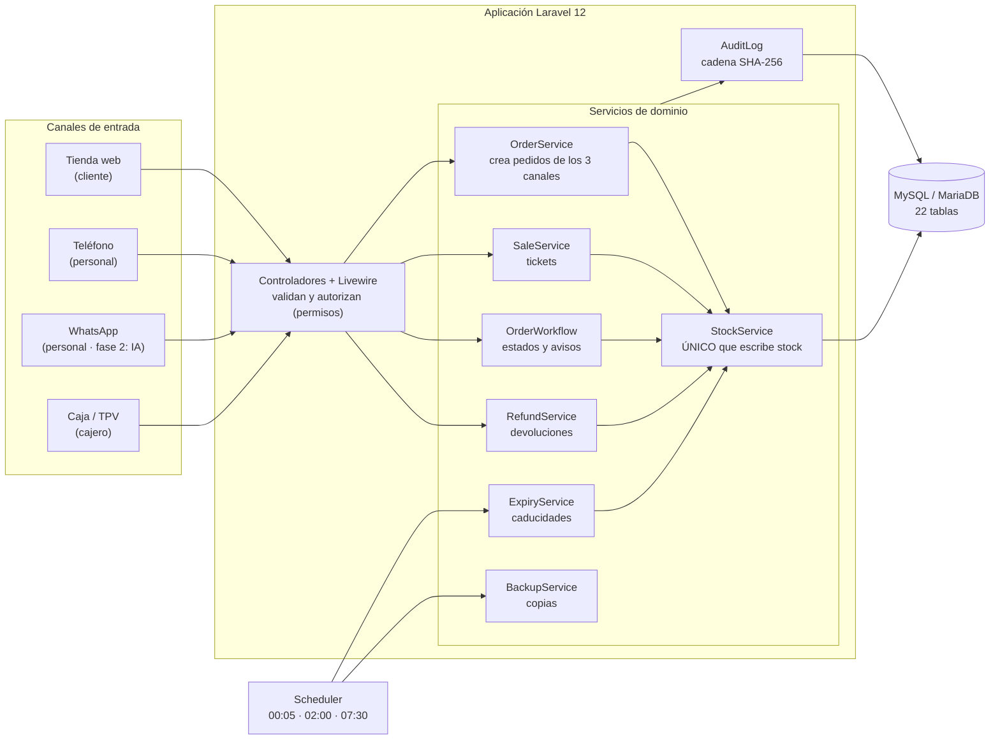
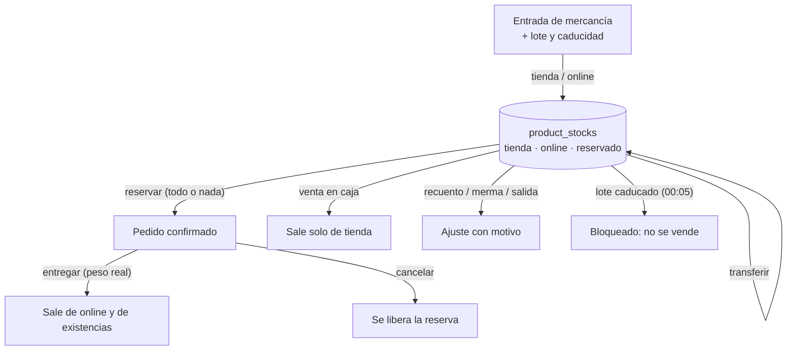
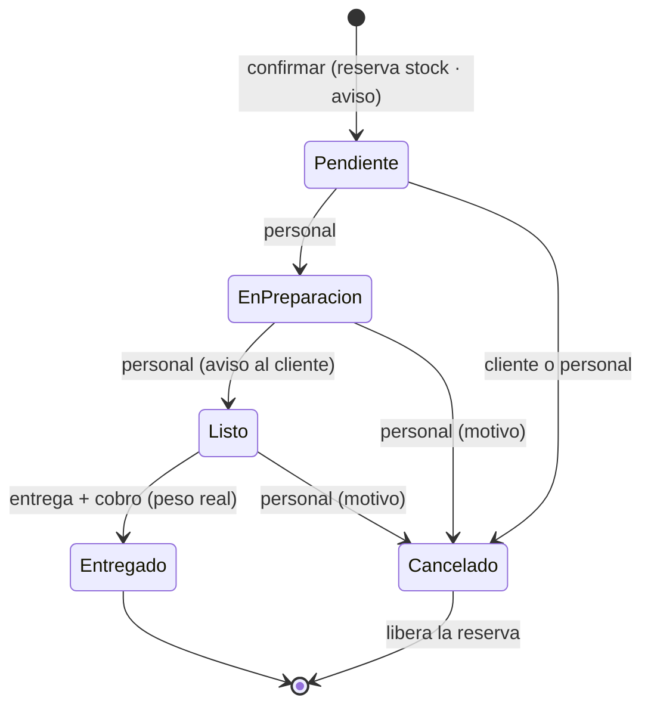
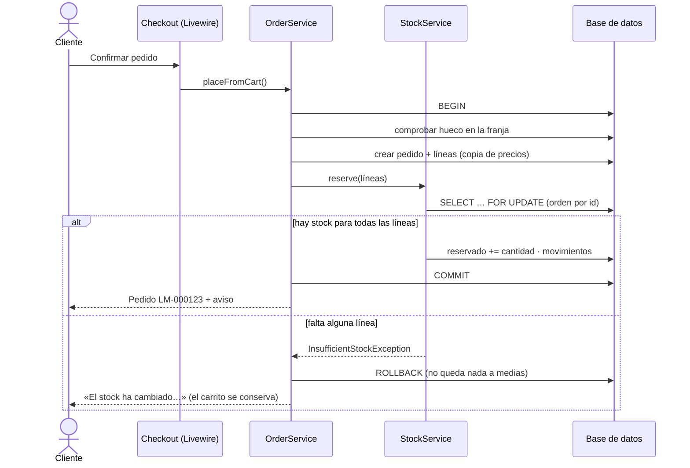

# Arquitectura

Arquitectura **real** de LocalMarket tal como está implementada (sustituye a la figura 1 de la propuesta). El modelo de datos completo está en [MODELO_DE_DATOS.md](MODELO_DE_DATOS.md).

## Vista general

## Capas

| Capa | Dónde | Responsabilidad |
|---|---|---|
| Rutas | `routes/{web,admin,staff,pos,warehouse}.php` | Cada grupo exige su **permiso** (`can:…`), nunca el nombre del rol. |
| Controladores / Livewire | `app/Http/Controllers`, `app/Livewire` | Validan la entrada y la convierten en llamadas a servicios. No tienen reglas de negocio. |
| Servicios | `app/Services` | Reglas de negocio y transacciones: stock, pedidos, ventas, devoluciones, caducidades, copias. |
| Modelos | `app/Models` | Relaciones, *casts*, enums y auditoría automática (`Auditable`). |
| Apoyo | `app/Support` | Objetos de valor y utilidades: `CartTotals`, `SaleTotals`, `Slots`, `CsvExport`, `Navigation`. |

## El stock: dos canales y un único punto de escritura

`StockService` es el **único** código que modifica `product_stocks`. Cada operación sigue el mismo patrón:

1. abre una transacción;
2. bloquea la fila con `lockForUpdate`;
3. valida que nada quede en negativo;
4. escribe una línea en `stock_movements`;
5. consume los lotes por orden de caducidad (FEFO).

Funciones de la sección 5 de la propuesta:

| Propuesta | Implementación |
|---|---|
| `consultar_stock` | `ProductStock::available_online` (online − reservado) |
| `reservar` | `StockService::reserve` (todas las líneas o ninguna) |
| `liberar_reserva` | `StockService::release` |
| `confirmar_entrega` | `StockService::deliver` (peso real) |
| `transferir` | `StockService::transfer` + `ChannelAllocator` |
| `ajustar` | `StockService::adjustCount` (motivo obligatorio) |

## Ciclo de vida de un pedido

`OrderWorkflow` bloquea el pedido, rechaza saltos o retrocesos, guarda cada cambio en `order_status_changes` y lanza `OrderStatusChanged`. El evento se emite **después del commit**, así que nunca se avisa de un cambio que se ha revertido.

## Confirmación de un pedido (reserva indivisible)

## Seguridad

- **Mínimo privilegio**: 20 permisos editables por rol. El rol de administración nunca puede perder `roles.manage`.
- **Contraseñas**: se guardan con hash y el login se bloquea tras 5 intentos fallidos. Una cuenta desactivada sale de la sesión en su siguiente petición.
- **Auditoría**: cada entrada guarda el hash de la anterior. `php artisan audit:verify` detecta cualquier modificación o borrado. Las operaciones sensibles se marcan aparte.
- **Datos de pago**: nunca se guardan datos de tarjeta, solo el código de autorización del datáfono.
- **Copias**: diarias, comprimidas y con rotación. La restauración solo se hace por consola y siempre con una copia previa ([BACKUP.md](BACKUP.md)).

## Tareas programadas

| Hora | Comando | Qué hace |
|---|---|---|
| 00:05 | `stock:block-expired` | Bloquea los lotes caducados para que no se vendan |
| 02:00 | `backup:run` | Copia de seguridad de la base de datos |
| 07:30 | `stock:expiry-alerts` | Avisa al almacén de los lotes que caducan pronto |

## Decisiones técnicas principales

| Decisión | Motivo |
|---|---|
| Blade + Livewire en lugar de una SPA | Interactividad (buscador, carrito, caja) sin una API separada; un solo lenguaje para un equipo de 1.º DAM/DAW. |
| Permisos como *abilities* del Gate | Rutas y vistas usan `can:`, así que el administrador puede cambiar lo que hace cada rol sin tocar código. |
| Códigos derivados del id | Correlativos (`LM-`, `T-`, `D-`) y sin condiciones de carrera. |
| Copia de precio y nombre en cada línea | Editar el catálogo no cambia pedidos ni tickets pasados. |
| Pagos en una tabla polimórfica | Caja, pedidos y devoluciones comparten un mismo informe de cobros por método. |
| CI en SQLite **y** MariaDB 10.4 | Rapidez en local y la misma base de datos que XAMPP en la entrega. |
