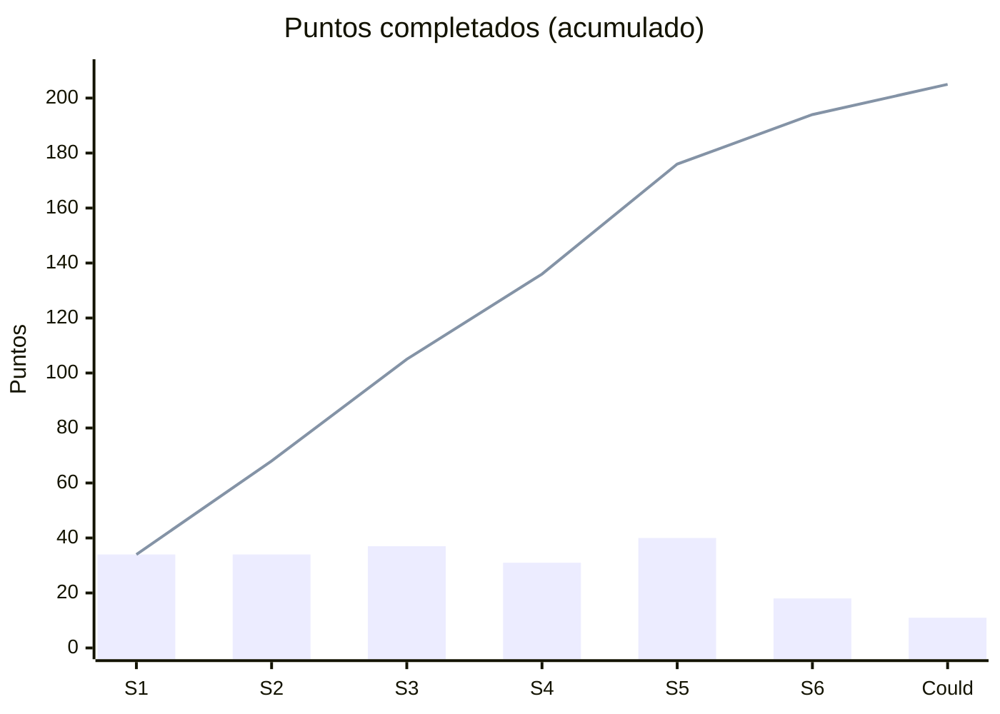
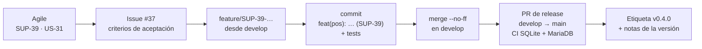

# Metodología ágil: Scrum + Kanban

Cómo se ha organizado el trabajo de LocalMarket, desde que se escribe una historia hasta que llega a `main`. El Product Backlog está en la plataforma Agile (proyecto **SUP – Supermercado Omnicanal**) y el código en GitHub. Las dos herramientas se enlazan con la referencia `SUP-XX`.

## 1. Por qué Scrum + Kanban

Como explicamos en la propuesta (sección 9.1), no elegimos Cascada. La propietaria necesita ver avances pronto y algunos requisitos estaban abiertos: el reparto online, la caja o una segunda tienda.

- **Scrum** marca el ritmo con Sprints de 2 semanas. Cada Sprint termina con un incremento que funciona y una versión etiquetada.
- **Kanban** muestra el flujo de cada día y limita el trabajo en curso.

## 2. Roles

| Rol | Responsabilidad en el proyecto |
|---|---|
| **Product Owner** | Representa a la propietaria de LocalMarket. Mantiene el Product Backlog ordenado por valor (MoSCoW), acepta o rechaza cada historia en la revisión del Sprint y aprueba la fusión de cada release en `main`. |
| **Scrum Master** | Facilita los eventos, vigila el límite WIP y la Definición de Hecho, y quita los bloqueos. |
| **Equipo de desarrollo** | Mohamed El Achiri, Victor Escobar, Rubi Fernández y Mohamed 2. Estima, divide las historias en tareas, desarrolla, prueba y documenta. |
| **Cliente** | Ana Beltrán, propietaria de LocalMarket. Da su opinión en cada revisión del Sprint. |

## 3. Eventos

| Evento | Cuándo | Qué se hace | Qué queda registrado |
|---|---|---|---|
| **Planificación del Sprint** | Al empezar el Sprint | Se fija el objetivo del Sprint. Se eligen historias que cumplen la DoR y se dividen en tareas técnicas. | Un *milestone* de GitHub por Sprint con su objetivo, y las historias movidas al Sprint en la plataforma Agile |
| **Reunión diaria** | Cada día, 15 min | Qué hice, qué haré y qué me bloquea | El estado de cada tarjeta en el tablero |
| **Revisión del Sprint** | Al terminar el Sprint | Demostración del incremento a la propietaria con los datos de demo | El Pull Request de release `develop → main` y su etiqueta `v0.X.0` |
| **Retrospectiva** | Después de la revisión | Qué mejorar en el siguiente Sprint | Las mejoras de proceso de la [sección 10](#10-retrospectivas-mejoras-incorporadas) |

## 4. Artefactos

| Artefacto | Dónde está |
|---|---|
| **Product Backlog** | En la plataforma Agile: 8 épicas (EPIC 1–8) con sus historias `US-XX` (clave `SUP-XX`), cada una con prioridad, puntos y responsable |
| **Sprint Backlog** | El *milestone* del Sprint en GitHub: una *issue* por historia o tarea, con sus criterios de aceptación como lista para marcar |
| **Incremento** | La rama `main` y su etiqueta (`v0.1.0` … `v0.7.0`), con las notas de la versión en *GitHub Releases* |

**Compromisos**:
- Producto: la propuesta (v3.3), que describe una plataforma omnicanal con un único stock coherente.
- Sprint: el objetivo del Sprint.
- Incremento: la Definición de Hecho.

## 5. Tablero Kanban

| Columna en la propuesta | Estado en Agile | Significado |
|---|---|---|
| Product Backlog | *(sin Sprint)* | Historias priorizadas que aún no están en ningún Sprint |
| To Do | To Do | Seleccionada para el Sprint en curso |
| Doing | In Progress | En desarrollo, en su rama `feature/SUP-XX-…` |
| Review / Testing | In Review | Se revisa la rama, CI está en verde y se comprueban los criterios de aceptación |
| Done | Done | Cumple la DoD y forma parte del incremento |

**Límite WIP**: como máximo **2 tarjetas en curso por persona**. Así se termina lo que ya está empezado antes de abrir algo nuevo.

## 6. Definición de Listo (Definition of Ready)

Una historia solo entra en la planificación del Sprint si cumple **todo** esto:

1. Tiene el formato **«Como `<rol>`, quiero `<acción>` para `<beneficio>`»**, y el rol es uno de los del sistema: cliente, caja, almacén o administración.
2. Tiene **criterios de aceptación** que se pueden comprobar, normalmente entre 3 y 5, escritos como lista en la *issue*.
3. Está **estimada en puntos** (escala Fibonacci 1, 2, 3, 5, 8, 13). Si pasa de **13 puntos**, se divide antes de entrar.
4. Tiene **prioridad MoSCoW** (Must, Should o Could) y está en su **épica** y su **módulo** (etiqueta `module:…`).
5. Sus **dependencias** están resueltas o van en el mismo Sprint. Por ejemplo, el carrito necesita el catálogo, y los pedidos necesitan la reserva de stock.
6. Las **reglas de negocio** que tengan dudas ya están aclaradas con la propietaria: plazos de devolución, el reparto online, las franjas horarias…
7. Tiene su ***issue* en GitHub** con la referencia `SUP-XX`, la prioridad y los puntos.

## 7. Definición de Hecho (Definition of Done)

Una historia está en **Done** solo cuando cumple **todo** esto:

**Funcionalidad**
- [ ] Cumple **todos** sus criterios de aceptación.
- [ ] Respeta los permisos: cada acción la comprueba una *Gate*. Las acciones sensibles quedan en el **historial de auditoría**.
- [ ] Si toca el stock, lo modifica **solo** a través de `StockService`. Nunca deja el stock por debajo de cero.

**Calidad**
- [ ] Tiene **tests de feature** en el mismo commit que la implementa.
- [ ] La suite completa pasa en **SQLite y en MariaDB 10.4** (GitHub Actions).
- [ ] Las migraciones nuevas son **reversibles**: CI migra, revierte todo y vuelve a migrar.
- [ ] Se ha **probado a mano en el navegador**, también en un móvil. Si aparece un error, se corrige en una rama `fix/…` con su **test de regresión**.

**Integración**
- [ ] El commit sigue *Conventional Commits* y lleva la referencia de la historia: `feat(pos): … (SUP-39)`.
- [ ] La rama `feature/SUP-XX-…` se ha fusionado en `develop` con `--no-ff`. Así queda en el historial qué commits forman la historia.
- [ ] La *issue* se cierra desde el commit o el PR (`Closes #NN`) y la tarjeta pasa a **Done** en Agile.

**Entrega**
- [ ] La documentación afectada está al día: README, manual, arquitectura y modelo de datos. El diagrama ER tiene un test que falla si deja de coincidir con las migraciones.
- [ ] Al cerrar el Sprint:
  - el PR de release `develop → main` está revisado y fusionado por otra persona del equipo;
  - existe la **etiqueta** `v0.X.0`;
  - hay **notas de la versión**.

## 8. Estimación y priorización

- **Puntos de historia** con *Planning Poker* sobre la escala de la plataforma: 0, 1, 2, 3, 5, 8, 13 y 21. Los puntos miden esfuerzo, complejidad y riesgo **relativos**, no horas. Las historias más sencillas, como *US-05: Cerrar sesión*, tienen 2 puntos; la mayoría tiene 3 o 5, y la más grande, *US-40: Actualizar y validar existencias en pedidos, ventas y cancelaciones*, tiene 8. Ninguna llegó a 13, así que no hubo que dividir ninguna historia antes de planificarla.
- **MoSCoW**:
  - los **Must** van primero en cada épica;
  - los **Should** completan cada Sprint;
  - los **Could** quedan para el final: *más vendidos*, *exportar informes* y *repetir pedido*.
- **Orden de los Sprints por dependencias**:
  1. usuarios y catálogo;
  2. tienda y stock;
  3. pedidos;
  4. caja;
  5. stock avanzado;
  6. informes y seguridad.

  Cada Sprint se apoya en el anterior.

## 9. Sprints

| Sprint | Objetivo | Historias y tareas | Puntos | Release |
|---|---|---|---:|---|
| **1** — Usuarios, Roles y Catálogo Base | Autenticación, roles y permisos, gestión de usuarios y catálogo base | SUP-9, 10, 11, 12, 13, 15, 16, 17, 18, 20 | 34 | `v0.1.0` · PR #22 |
| **2** — Tienda Online, Carrito y Stock Base | Comprar online con el carrito validado contra el stock disponible, y entradas de almacén | SUP-14, 19, 21, 22, 24, 27, 42, 43 + tareas SUP-63, 64, 65 | 34 | `v0.2.0` · PR #23 |
| **3** — Pedidos Multicanal | Pedidos de web, teléfono y WhatsApp en un único panel, con su ciclo de vida | SUP-25, 28, 29, 30, 31, 32, 33, 34, 48 | 37 | `v0.3.0` · PR #33 |
| **4** — Pagos y TPV | Caja, cobros y métodos de pago | SUP-35, 36, 37, 38, 39, 40, 41 | 31 | `v0.4.0` · PR #41 |
| **5** — Stock Avanzado, Lotes y Caducidades | Lotes, caducidades, transferencias y ajustes | SUP-44, 45, 46, 49, 50, 51, 52, 53, 54, 55 | 40 | `v0.5.0` · PR #52 |
| **6** — Panel, Informes y Seguridad | Panel, informes y seguridad operativa | SUP-56, 57, 60, 61 | 18 | `v0.6.0` · PR #57 |
| Backlog *Could* | Las tres historias *Could* pendientes | SUP-26, 58, 59 | 11 | `v0.7.0` · PR #61 |
| Preparación de la entrega | Datos de demo, validación en MySQL, menú y documentación | #62 – #67, #69 | — | PR #68 |

Las tareas de la preparación de la entrega no son historias del Product Backlog, así que no suman puntos.

**Velocidad**: 194 puntos en 6 Sprints, una media de **32 puntos por Sprint**. El Sprint 6 es más corto (18 puntos) porque *US-50* y *US-51* son *Could* y se pasaron a un release propio. Así el Sprint terminó con todos los **Must** hechos: las copias de seguridad, *US-53*.

### Burn-up del Product Backlog (205 puntos)

Las barras son los puntos de cada Sprint y la línea el total acumulado. Al final, el Product Backlog está **completo** (205 de 205 puntos) y el tablero de Agile no tiene nada abierto.

## 10. Retrospectivas: mejoras incorporadas

Cada retrospectiva dejó una mejora concreta en el proceso:

| Sprint | Qué pasó | Qué cambiamos |
|---|---|---|
| 4 | En la prueba manual de la caja, dos lecturas rápidas del escáner se perdían o se juntaban (`fix/SUP-37-…`) | La **prueba manual en el navegador** pasa a la DoD, y cada error lleva su test de regresión |
| 6 | Los contadores del panel mostraban «2.00»: el alias `total` chocaba con un *cast* decimal (`fix/SUP-31-order-count-alias`) | Los alias de las consultas de agregación no repiten nombres de columnas con *cast* |
| 6 | Una migración no se podía revertir en SQLite (`fix/SUP-10-reversible-is-active-migration`) | CI comprueba que **todas las migraciones son reversibles** (está en la DoD) |
| Entrega | Algunos tests suponían ids que empezaban en 1, y en MySQL fallaban | Un **segundo trabajo de CI con MariaDB 10.4**, la versión de XAMPP. Los tests leen los códigos de los registros |
| Entrega | Con 16 enlaces, el menú de administración no se podía usar, y el último desplegable se salía de la pantalla (`fix/menu-dropdown-overflow`) | Menú agrupado en 7 entradas. Se revisa también la navegación de cada rol |

## 11. Trazabilidad y flujo de Git

| Rama | Uso |
|---|---|
| `main` | Lo entregado al final de cada Sprint, con su etiqueta. Solo cambia con un PR revisado |
| `develop` | Donde se integra el Sprint en curso |
| `feature/SUP-XX-…` | Una rama por historia o tarea |
| `fix/SUP-XX-…` | La corrección de un error, con su test de regresión |
| `docs/…` | Cambios solo de documentación |

Cada pieza del proceso queda registrada, así que se puede seguir:

- de la historia en el tablero a su *issue*;
- de la *issue* a su rama y a sus commits;
- de los commits a sus tests;
- y de ahí al release en el que se entregó.

Por ejemplo, `git log --grep "SUP-39"` muestra todo lo que se hizo para *US-31*.
