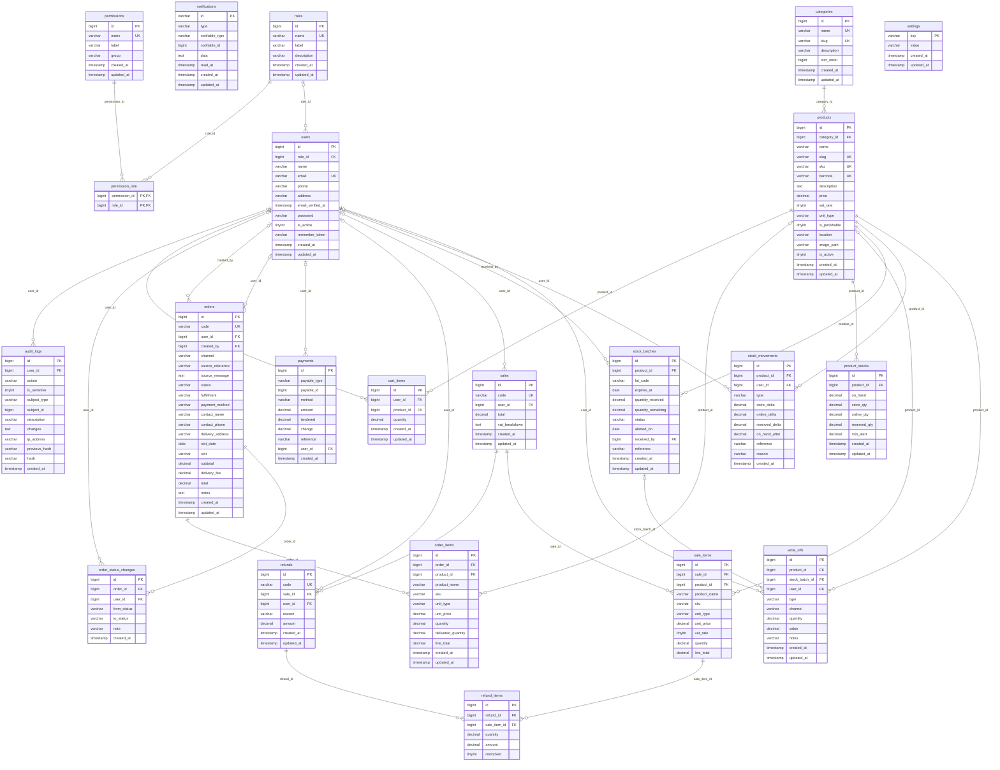

# Modelo de datos

Diagrama entidad-relación **real** de LocalMarket: se genera directamente a partir de las migraciones aplicadas a la base de datos. Sustituye al «modelo conceptual» de la propuesta (figura 2).

```bash
php artisan docs:er-diagram --write   # regenera este diagrama
```

GitHub muestra el diagrama directamente (Mermaid). `PK` = clave primaria, `FK` = clave foránea, `UK` = valor único.

<!-- er:start -->

<!-- er:end -->

## Cómo leerlo por módulos

| Módulo | Tablas | Notas |
|---|---|---|
| Usuarios y roles | `users`, `roles`, `permissions`, `permission_role` | Cada usuario tiene un rol. Los permisos son *abilities* del Gate (`can:stock.adjust`). |
| Catálogo | `categories`, `products` | `unit_type` (unidad / peso), `vat_rate` (4/10/21 %), `barcode` EAN-13, `is_perishable`. |
| Stock | `product_stocks`, `stock_batches`, `stock_movements`, `write_offs` | Dos stocks coordinados en `product_stocks` (tienda / online / reservado). `stock_movements` es el libro de movimientos: solo se añaden filas, nunca se modifican. |
| Tienda online | `cart_items`, `orders`, `order_items`, `order_status_changes` | Las líneas guardan una copia del nombre, el precio y el IVA del momento. `order_status_changes` es la línea de tiempo del pedido. |
| Caja | `sales`, `sale_items`, `refunds`, `refund_items` | Ticket `T-…` (factura simplificada) y devolución `D-…`. |
| Pagos | `payments` | **Polimórfica** (`payable_type` / `payable_id`): tickets, pedidos cobrados y devoluciones (importe negativo). |
| Seguridad | `audit_logs`, `settings`, `notifications` | `audit_logs` encadenado con SHA-256 (`previous_hash` → `hash`). La relación con el sujeto (`subject_type` / `subject_id`) es polimórfica. |

Las relaciones polimórficas (`payments.payable`, `audit_logs.subject`, `notifications.notifiable`) no aparecen como líneas en el diagrama porque no son claves foráneas de la base de datos: las resuelve Eloquent.

## Reglas que garantiza el esquema

- `disponible online = online_qty − reserved_qty`, nunca negativo. Todas las escrituras pasan por `StockService`, con bloqueo de fila (`lockForUpdate`).
- Se puede eliminar un producto sin perder la historia: las líneas de pedido, ticket y devolución guardan su copia y la clave foránea pasa a `NULL` (`nullOnDelete`).
- Las categorías con productos no se pueden borrar (`restrictOnDelete`).
- Los códigos públicos (`LM-000001`, `T-000001`, `D-000001`) salen del id autoincremental: son correlativos y no hay condiciones de carrera.
